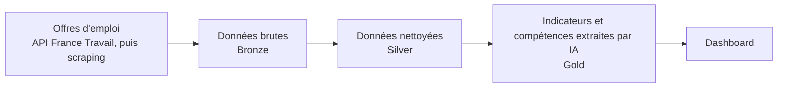

# Data & AI Job Market Intelligence

**Quelles compétences, technologies et salaires le marché recherche-t-il vraiment pour les métiers de la Data et de l'IA ?**

Ce projet construit une plateforme de données de bout en bout qui collecte automatiquement les
offres d'emploi (Data Engineer, Data Scientist, AI Engineer…), les nettoie, puis en extrait les
tendances grâce à l'IA.

> 🚧 Projet en cours de développement : voir l'[avancement](#avancement) ci-dessous.

---

## En bref

| | |
|---|---|
| **Problème** | Les offres d'emploi sont dispersées et non structurées : difficile de savoir quelles compétences montent ou quels salaires sont proposés. |
| **Solution** | Un pipeline automatisé qui collecte, structure et analyse les offres chaque jour. |
| **Résultat attendu** | Un tableau de bord des tendances : compétences les plus demandées, technologies émergentes, salaires par métier et par région. |

## Comment ça marche



1. **Collecte** : récupération quotidienne des offres via l'API officielle France Travail.
2. **Nettoyage** : normalisation des intitulés de poste, des dates et des localisations.
3. **Enrichissement IA** : extraction automatique des compétences mentionnées dans chaque offre.
4. **Restitution** : indicateurs prêts à l'analyse et dashboard.

## Stack technique

| Étape | Outils |
|---|---|
| Collecte | Python, API REST (OAuth 2.0) |
| Stockage | DuckDB |
| Transformation | dbt (architecture Medallion : Bronze / Silver / Gold) |
| IA | Extraction de compétences, LLM |
| Orchestration | Apache Airflow |
| Infrastructure | Docker |

## Compétences mises en œuvre

- **Data Engineering** : ingestion depuis une API, automatisation et planification de pipelines
- **Analytics Engineering** : modélisation des données avec dbt, tests de qualité
- **AI Engineering** : utilisation de LLM pour structurer du texte libre

## Avancement

- [x] Architecture et structure du projet
- [ ] Collecte des offres via l'API France Travail
- [ ] Stockage des données brutes (Bronze)
- [ ] Nettoyage des données avec dbt (Silver)
- [ ] Automatisation quotidienne avec Airflow
- [ ] Extraction des compétences par IA (Gold)
- [ ] Dashboard

## Organisation du dépôt

```
ingestion/        Collecte des offres
transformation/   Nettoyage et modélisation (dbt)
ai/               Extraction de compétences
airflow/          Automatisation du pipeline
infrastructure/   Docker
```
