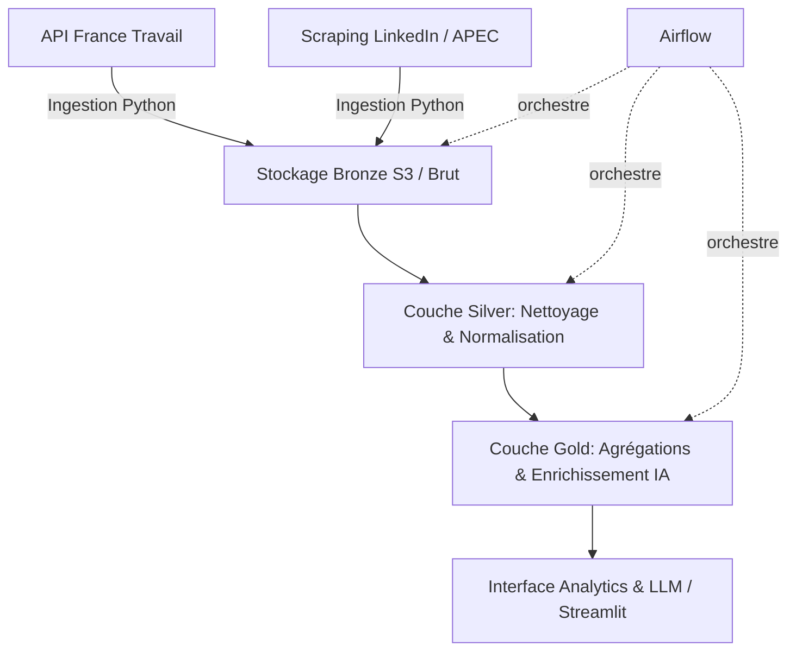

# Data-AI-Job-Market-Intelligence
End-to-end data platform for analyzing Data &amp; AI job market trends, combining Data Engineering, Analytics Engineering and AI Engineering.

Plateforme de données de bout en bout (End-to-End Data Platform) conçue pour analyser les tendances du marché de l'emploi sur les métiers de la **Data** et de l'**IA**, combinant les meilleures pratiques du **Data Engineering**, de l'**Analytics Engineering** et de l'**AI Engineering**.

---

## Objectif du Projet
Ce projet a été conçu pour répondre à une problématique concrète : *Comment capter, structurer et analyser en temps réel l'évolution des compétences, des technologies et des salaires demandés sur le marché des métiers de la Data et de l'IA (Data Engineer, AI Engineer, Data Scientist, etc.) ?*

Il démontre la maîtrise d'une stack moderne de type **Data Lakehouse** et l'automatisation de pipelines de données en production.

---

## Architecture & Flux de Données

Le pipeline repose sur une architecture en couches (Medallion Architecture revisitée) :



Implémentation actuelle (stockage local DuckDB) :

```
API France Travail ──► ingestion/ ──► raw.job_offers (Bronze, DuckDB)
                                            │
                                 transformation/ (dbt) ──► silver.*
                                            │
                                 ai/extractor.py ──► ai.job_offer_skills
                                            │
                                 transformation/ (dbt) ──► gold.*
         Airflow (DAG job_market_pipeline) orchestre les étapes chaque jour
```

---

## Structure du dépôt

```
airflow/            Orchestration : DAGs et image Docker Airflow
  dags/
  Dockerfile
ingestion/          1. Extraction (API France Travail, puis scraping)
  france_travail_client.py   client OAuth2 + recherche paginée
  main_ingest.py             chargement dans raw.job_offers
transformation/     2. Modélisation dbt (Silver, Gold)
  models/silver/
  models/gold/
  dbt_project.yml
ai/                 3. Composants IA (extraction de compétences, LLM)
  extractor.py
data/               Fichiers locaux & base DuckDB (ignorés par Git)
infrastructure/     docker-compose (Airflow…)
requirements.txt    Dépendances Python
```

## Démarrage rapide

Prérequis : Python 3.12+, Docker.

```bash
cp .env.example .env              # renseigner les identifiants France Travail
python -m venv .venv && source .venv/bin/activate
pip install -r requirements.txt
```

Exécution manuelle du pipeline (depuis la racine du dépôt) :

```bash
set -a && source .env && set +a
python -m ingestion.main_ingest                                  # Bronze
(cd transformation && dbt build --profiles-dir . --select silver) # Silver
python -m ai.extractor                                           # compétences
(cd transformation && dbt build --profiles-dir . --select gold)   # Gold
```

Exécution orchestrée par Airflow (UI sur http://localhost:8080, le mot de passe
`admin` est affiché dans les logs du conteneur) :

```bash
docker compose -f infrastructure/docker-compose.yml up --build
```

## Principes

1. **Une responsabilité par dossier** : `ingestion/` collecte, `transformation/` modélise, `ai/` enrichit, `airflow/` orchestre.
2. **Bronze immuable** : le payload source est conservé intact, chaque version d'offre est identifiée par un hash SHA-256.
3. **Données et secrets hors de Git** : `.env` et `data/` sont ignorés.

## Feuille de route

- [x] Structure du projet
- [ ] Connecteur France Travail testé de bout en bout
- [ ] Modèles dbt Silver / Gold complets et testés
- [ ] Orchestration Airflow quotidienne
- [ ] Extraction de compétences par LLM
- [ ] Scraping de sources complémentaires
- [ ] Dashboard
